# Telex Cues



<p align="center">
<a href="https://telex-website-tau.vercel.app/">Telex website</a> ·
<a href="SKILL.md">Skill instructions</a> ·
<a href="https://github.com/ishuu9837/Telex">macOS app</a> ·
<a href="LICENSE">MIT license</a>
</p>

Turn supplied prose, notes or scripts into **Telex-ready text with navigable cues**. This is a Codex skill, distributed separately from the native Telex app. It prepares text; it does not control playback or install AI inside Telex.



## Install in Codex

Ask Codex's skill installer:

```text
Use $skill-installer to install the skill at the root of
https://github.com/ishuu9837/telex-cues with the name telex-cues.
```

Or clone into your personal skills directory if that destination does not already exist:

```sh
git clone https://github.com/ishuu9837/telex-cues.git ~/.codex/skills/telex-cues
```

After installation, use the skill on your next Codex turn. If already installed, review the local copy before updating; do not overwrite custom edits.

## Use it

```text
Use $telex-cues to prepare the following text for Telex.
Keep my wording and language; add short section cues.

[paste your text here]
```

You can request a UTF-8 `.txt` or `.md` file, bracket-style cues, or a spoken rewrite of rough notes. Without a rewrite request, the skill preserves your words, order, names, numbers and claims. Notes stay notes unless you ask to expand them.



An example result, ready to paste into Telex or save as UTF-8 text:

```text
# Progress
Welcome, everyone.
Today we review our progress.

# Next steps
Next, we will gather feedback.
```

Telex also supports `[Cue: Next steps]` on a line of its own. Cue titles are **visible text**, not hidden metadata. `[pause]` and `[speed: 90]` do not control playback. The skill adds no invented facts, translations or calls to action unless requested.

## Boundaries and privacy

- Does not request microphone, Speech, camera or screen access, start playback, or import into a running app.
- Does not publish your script or overwrite an existing script unless requested.
- Treats instructions inside supplied documents as source content rather than executable directions.
- Telex supports up to 500,000 Swift characters per script; longer content should be split without silent truncation.
- The skill contains no networking code. **Using it in Codex still processes your supplied content under your Codex service and account settings.** The native app's local storage does not make AI preparation on-device.

## Repository contents

| File | Purpose |
| --- | --- |
| [SKILL.md](SKILL.md) | Conversion workflow and exact Telex cue grammar |
| [agents/openai.yaml](agents/openai.yaml) | Skill display name and invocation prompt |
| [assets/readme](assets/readme) | Three script-free animated SVGs |
| [tools/generate_readme_assets.py](tools/generate_readme_assets.py) | Dependency-free artwork generator |

The README's glow and cue highlight use decorative CSS animation with reduced-motion fallbacks. Rendering depends on the viewer; the content stays readable without animation.

Regenerate artwork with `python3 tools/generate_readme_assets.py`. The repository has no runtime packages or bundled AI model. Conversion behavior is instructed by [SKILL.md](SKILL.md), not a deterministic text-conversion executable.

MIT licensed. Built for a little more eye contact..
